# 🏏 AthleteRise: AI-Powered Multi-Shot Cricket Analytics

[](https://www.python.org/downloads/release/python-3100/)
[](https://developers.google.com/mediapipe)
[](https://streamlit.io/)
[](https://opencv.org/)
[]()
[](https://www.python.org/downloads/release/python-3100/)
[](https://developers.google.com/mediapipe)
[](https://streamlit.io/)
[](https://opencv.org/)
[]()
[]()
[]()

---

## 🌐 Live Demo

**Try AthleteRise:** [Launch the public Streamlit application](https://ai-powered-multi-shot-cricket-batting-analytics-jw563gyvnpfn3c.streamlit.app/)

> Hosted on Streamlit Community Cloud. The app may take a short time to wake up after a period without visitors.

---

**AthleteRise** is an automated, markerless computer-vision system designed for multi-shot cricket batting biomechanics analysis. Operating on monocular 2D standard-definition and high-definition video, AthleteRise applies CLAHE lighting normalization, tracks 15 full-body skeletal keypoints using Google MediaPipe Pose, detects stroke phases and bat–ball impact moments via multi-signal kinematic fusion, classifies strokes across three major shot archetypes (**Cover Drive**, **Straight Drive**, and **Pull Shot**), and evaluates biomechanical technique against empirical statistical distributions ($N=30$, 10 benchmark clips per shot class) with continuous non-linear scoring, dynamic occlusion handling, and human-in-the-loop ground-truth validation.

---

## 📖 Complete Technical Documentation

> [!IMPORTANT]
> **Authoritative Technical Documentation:**  
> 📑 **[PROJECT_MASTER_DOCUMENTATION.md](docs/PROJECT_MASTER_DOCUMENTATION.md)** — The comprehensive, authoritative master document containing the complete technical audit, mathematical formulas, 10 core + shot-specific biomechanical metrics, statistical calibration methodology, multi-signal contact detection, and 43-case test verification.

---

## 🎯 Problem Statement

Traditional cricket coaching and biomechanical assessment rely heavily on subjective visual observation or expensive marker-based 3D motion-capture laboratories (e.g., Vicon) requiring wearable sensors that restrict natural player movement. Furthermore:
1. **Subjectivity:** Coach evaluations often vary significantly due to human visual limitations at high ball speeds.
2. **Single-Shot Limitation:** Prior automated cricket tools only addressed isolated strokes (such as single cover drives) without shot classification or shot-specific biomechanical models.
3. **Contact Detection Ambiguity:** Accurately localizing the exact frame of bat-ball impact from monocular broadcast or training video is challenging due to high bat speeds and motion blur.
4. **Lack of Empirical Baselines:** Existing platforms often score technique against arbitrary hardcoded angles rather than empirical distributions derived from high-level technical references.

AthleteRise solves these challenges by combining markerless deep pose estimation, trajectory change analysis, shot classification, empirical percentile-based scoring ($P_{10} - P_{90}$), and interactive visual telemetry into an accessible web dashboard.

---

## 🌟 Main Objectives

- **Automated Multi-Shot Analysis:** Automatically classify the stroke played (**Cover Drive**, **Straight Drive**, **Pull Shot**, or **Unknown**) without manual pre-labeling.
- **Markerless Kinematic Tracking:** Extract 15 spatial-temporal skeletal keypoints with scale-invariance normalized by player torso length.
- **Multi-Signal Bat-Ball Contact Fusion:** Estimate contact frame using spatial proximity, velocity vectors, trajectory inflection, and pose impact windows.
- **Empirical Reference Calibration:** Benchmark technique against calibrated statistical baselines ($N=30$ dedicated video clips), computing 11 statistical descriptors (Mean, Median, Std Dev, Variance, Min, Max, Q1, Q3, IQR, P10, P90).
- **Interactive Coaching Dashboard:** Provide coaches and players with immediate visual overlays, biomechanical scorecards, temporal smoothness curves, and downloadable PDF/HTML reports.
- **Human-in-the-Loop Validation:** Provide annotation tools to confirm contact frames and build expanding validation datasets.

---

## ⚡ Key Features

- **3-Tab Modular Interface:**
  1. `🎥 Single Video Shot Analysis`: Video upload, automatic shot classification, bat-ball contact detection, 10 core biomechanical metrics, percentile scorecard, and annotated video player.
  2. `📐 Multi-Shot Reference Calibration`: Statistical reference browser, per-metric box plots, comparative cross-shot diagnostics, and one-click recalibration across 30 dedicated reference clips.
  3. `🎯 Contact Validation & Annotation`: Human-in-the-loop review of candidate contact frames (Before / Contact / After) to confirm ground truth and track detector precision/recall.
- **10 Core Biomechanical Metrics:**
  - Front Elbow Angle (°)
  - Spine Lean Tilt (°)
  - Head–Knee Alignment (torso-normalized distance)
  - Front Foot Direction (°)
  - Shoulder Rotation (°)
  - Hip Rotation (°)
  - Stride Length (torso-normalized ratio)
  - Head Stability (drift standard deviation)
  - Follow-Through Angle (°)
  - Follow-Through Quality (0–100 score)
- **Shot-Specific Distinguishing Metrics:**
  - Rotary Shoulder Differential (°)
  - Wrist Horizontal & Vertical Travel (torso-normalized)
- **Continuous Non-Linear Percentile Scoring:**
  - Eliminates brittle binary pass/fail thresholds.
  - Scores scale smoothly within the empirical 10th-to-90th percentile bounds ($P_{10} - P_{90}$).
- **Automated Report Generation:**
  - Full HTML & downloadable JSON telemetry outputs.
  - Diagnostic matrix comparing Cover Drive vs. Straight Drive vs. Pull Shot technique.
- **Robustness & Fallback Handling:**
  - Dual MediaPipe support (MediaPipe Tasks API `pose_landmarker_lite.task` with automatic fallback to MediaPipe Solutions Pose).
  - Works on both left-handed and right-handed batsmen.
  - Dynamic occlusion handling with optical-flow keypoint propagation.

---

## 🏗️ System Architecture

<p align="center">
     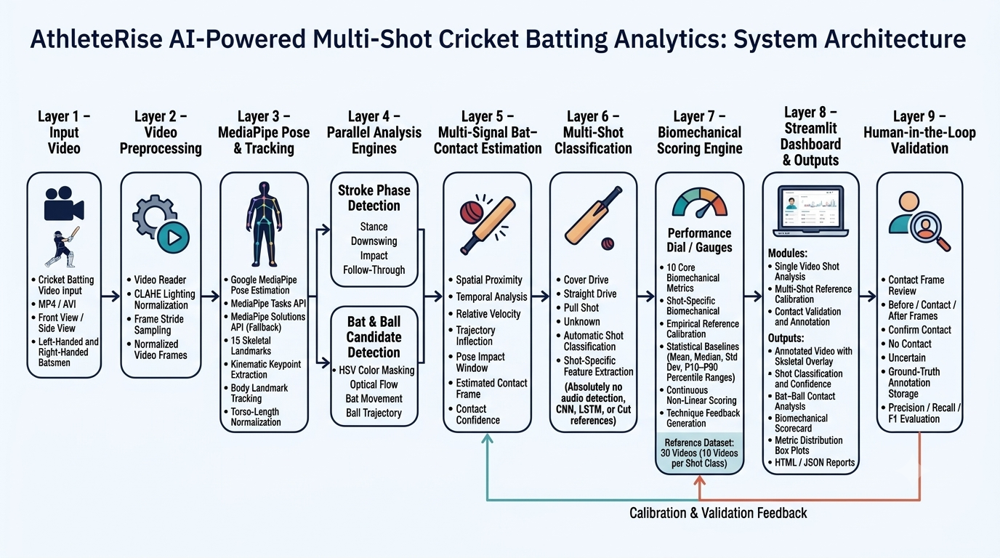
</p>

The pipeline runs in nine layers, from raw video input to human-in-the-loop validation. Calibration and validation feedback loops back into contact estimation and the scoring engine.

<details>
<summary><b>View the interactive flowchart (Mermaid)</b></summary>

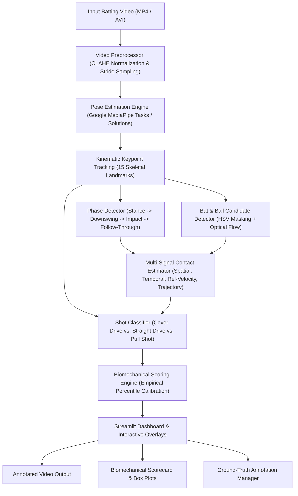

</details>

---

## 🛠️ Technology Stack

| Layer | Technologies / Libraries |
| :--- | :--- |
| **Language** | Python 3.10+ (tested on 3.10 and 3.14) |
| **Web Application** | Streamlit (v1.32.0 – v1.60.0) |
| **Computer Vision** | OpenCV Headless (`opencv-python-headless`), Google MediaPipe (`mediapipe 0.10.x`) |
| **Biomechanical Math** | NumPy, Pandas, SciPy |
| **Data Visualization** | Matplotlib, Streamlit Charts |
| **Model Artifacts** | `pose_landmarker_lite.task` (TFLite CPU delegate) |
| **Testing** | Python `unittest` (43 automated test cases passing) |
| **Deployment Target** | Streamlit Community Cloud (Debian Linux, Python 3.11) |

---

## 📁 Project Folder Structure

```
AI-Powered-Cricket-Analytics-main/
│
├── .streamlit/
│   └── config.toml               # Streamlit server, upload limit (200MB), and theme settings
├── calibration_dataset/          # Reference dataset documentation
│   └── cover_drive/README.txt
├── data/
│   ├── contact_annotations/      # Stored human-in-the-loop ground-truth labels
│   │   └── temp_contact_label.json
│   └── reference_videos/         # Dedicated empirical calibration clips (30 clips, ~45.5 MB)
│       ├── cover_drive/          # 10 Cover Drive reference clips (cover_0001 - cover_0010.avi)
│       ├── straight_drive/       # 10 Straight Drive reference clips (straight_0101 - straight_0110.avi)
│       └── pull_shot/            # 10 Pull Shot reference clips (pull_0111 - pull_0120.avi)
├── docs/
│   ├── PROJECT_MASTER_DOCUMENTATION.md  # Complete mathematical audit and technical specs
│   └── system_architecture.png          # 9-layer system architecture diagram
├── examples/                     # Demonstration animations and telemetry graphs
│   ├── annotated_video.gif
│   ├── annotated_left_hander_batsmen.gif
│   ├── annotated_left_side_angle.gif
│   ├── input_video.gif
│   ├── input_left_hander_batsmen.gif
│   ├── input_left_side_angle.gif
│   ├── temporal_smoothness.png
│   └── evaluation.json
├── frames/                       # Frame storage directory (retained via .gitkeep)
│   └── .gitkeep
├── output/                       # Generated analysis artifacts & calibration baselines
│   └── reference_calibration/    # Precomputed empirical baselines for all 3 shots
│       ├── cover_drive/          # Reference JSON, statistics CSV, distribution PNG, HTML report
│       ├── straight_drive/       # Reference JSON, statistics CSV, distribution PNG, HTML report
│       ├── pull_shot/            # Reference JSON, statistics CSV, distribution PNG, HTML report
│       ├── calibration_diagnostics.txt
│       └── calibration_validation_report.txt
├── scripts/                      # Evaluation & dataset inspection utilities
│   ├── evaluate_dataset.py
│   ├── evaluate_models.py
│   ├── generate_multishot_dataset.py
│   └── inspect_per_video.py
├── src/                          # Modular core application logic
│   ├── biomechanics/             # Metrics calculators & scale invariance algorithms
│   ├── calibration/              # Reference calibration engines & statistical analyzers
│   ├── contact_detection/        # Bat-ball visual detector, contact estimator & validator
│   ├── evaluation/               # Shot-specific scoring engines & feedback generators
│   ├── phase_detection/          # Stroke phase segmentation engines
│   ├── pose_estimation/          # MediaPipe vision posture tracker
│   ├── preprocessing/            # Video reader, CLAHE normalization, stride sampling
│   ├── report/                   # HTML/PDF calibration report generator
│   ├── reporting/                # Multi-shot and contact text formatters
│   └── shot_analysis/            # Shot classifier, config, and feature extractors
├── tests/                        # Automated unit test suite (43 test cases)
│   ├── test_audit_architecture.py
│   ├── test_audit_step19_pipeline.py
│   ├── test_biomechanical_statistics.py
│   └── test_multi_shot_analysis.py
│
├── .gitattributes                # Git text normalization and binary settings
├── .gitignore                    # Production deployment ignore rules
├── app.py                        # Streamlit web application entry point
├── calibrate_references.py       # Standalone calibration orchestrator
├── config.json                   # Pipeline configuration thresholds
├── cover_drive_analysis_realtime.py # Core analysis pipeline CLI
├── packages.txt                  # Linux system packages for Streamlit Cloud (ffmpeg, libgl1)
├── pose_landmarker_lite.task     # MediaPipe PoseLandmarker model weights (5.51 MB)
├── README.md                     # Project documentation
├── requirements.txt              # Production Python dependencies
│
├── Cover_drive_Input.mp4         # Sample Cover Drive input video (1.82 MB)
├── Cover_drive_Input_2.mp4       # Sample Cover Drive input video #2 (5.11 MB)
├── Pull_Shot_Input.mp4           # Sample Pull Shot input video (3.10 MB)
└── Straight_drive_Input.mp4      # Sample Straight Drive input video (1.10 MB)
```

---

## 💻 Installation & Setup

### Prerequisites
- Python **3.10** (recommended) or 3.11 / 3.12 / 3.14
- Git

### 1. Clone the Repository
```bash
git clone https://github.com/NShiddharth/AI-Powered-Multi-Shot-Cricket-Batting-Analytics.git
cd AI-Powered-Multi-Shot-Cricket-Batting-Analytics
```

### 2. Create and Activate Virtual Environment
```bash
# Windows
py -3.10 -m venv cricket_analytics
cricket_analytics\Scripts\activate

# Linux / macOS
python3.10 -m venv cricket_analytics
source cricket_analytics/bin/activate
```

### 3. Install Dependencies
```bash
pip install -r requirements.txt
```

---

## 🚀 Running the Application Locally

### Option A: Launch Interactive Streamlit Web App (Recommended)
```bash
streamlit run app.py
```
Open your browser at `http://localhost:8501`.

### Option B: Standalone CLI Video Analysis
```bash
# Analyze a sample video with automatic shot classification
python cover_drive_analysis_realtime.py --video Cover_drive_Input.mp4

# Run with custom configuration
python cover_drive_analysis_realtime.py --video Straight_drive_Input.mp4 --config config.json
```

### Option C: Re-run Full Empirical Reference Recalibration
```bash
python calibrate_references.py
```

### Option D: Run Automated Unit Tests
```bash
python -m unittest discover tests
```
*All 43 unit tests execute in ~11 seconds and verify architecture, scoring, phase detection, contact estimation, and statistical distributions.*

---

## 📖 How to Use the Application

### 1. Single Video Shot Analysis (`Tab 1`)
1. Open the web app at `http://localhost:8501`.
2. Under **Shot Classification Mode**, leave as `Auto-Detect Shot (Recommended)` or choose a forced baseline.
3. Click **Browse files** and upload an MP4 or AVI video (you can use one of the bundled sample videos: `Cover_drive_Input.mp4`, `Straight_drive_Input.mp4`, or `Pull_Shot_Input.mp4`).
4. Click **🚀 Run Batting Analysis**.
5. Inspect:
   - **Annotated Video Overlay** with skeletal wireframe, bat path, and impact telemetry.
   - **Classification Result** showing predicted shot type and confidence percentage.
   - **Bat–Ball Contact Analysis** displaying contact status, frame number, proximity, and multi-signal breakdown.
   - **Biomechanical Scorecard** with measured values, baseline means, $P_{10} - P_{90}$ ranges, and technique advice.
   - **Reference Baseline Distribution Expander** displaying box plots across the 10 benchmark reference clips.

### 2. Multi-Shot Reference Calibration (`Tab 2`)
1. Select the shot class (**Cover Drive**, **Straight Drive**, or **Pull Shot**).
2. View the precomputed empirical dataset statistics ($N=10$ clips per shot) across all 10 biomechanical metrics.
3. Toggle between **Multi-Metric Overview** (grid of box plots) and **Single Metric Deep Dive** with per-video data.
4. Download the high-resolution Distribution Dashboard (`PNG`) or full HTML Calibration Report.
5. Optionally click **▶ Run Calibration** to reprocess all dedicated video clips and update the empirical distribution in real-time.

### 3. Contact Validation & Annotation (`Tab 3`)
1. View the total number of stored ground-truth contact labels.
2. Review the 3-frame impact window extracted from the most recently analyzed video:
   - **Frame Before**
   - **🎯 Candidate Contact Frame**
   - **Frame After**
3. Click **✅ CONFIRM CONTACT**, **❌ NO CONTACT**, or **❓ UNCERTAIN** to save the human-verified label into `data/contact_annotations/`.
4. The detector's precision, recall, and F1-score automatically update against verified ground truth.

---

## 🎥 Visual Demonstrations

| Front Angle | Side Angle | Left-Handed Batsman |
| :---: | :---: | :---: |
| **Input Clip** | **Input Clip** | **Input Clip** |
| 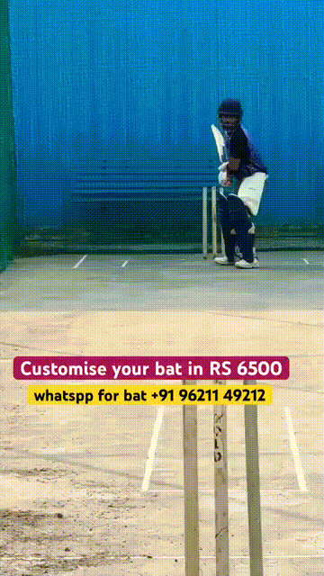 | 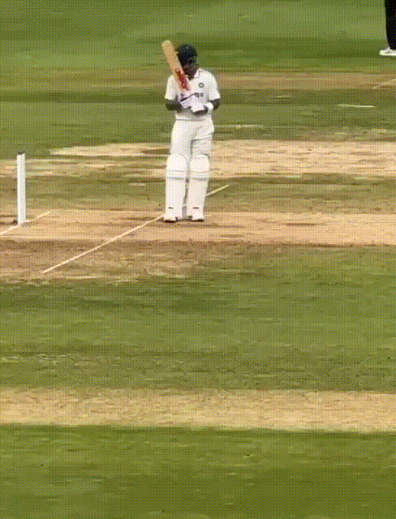 | 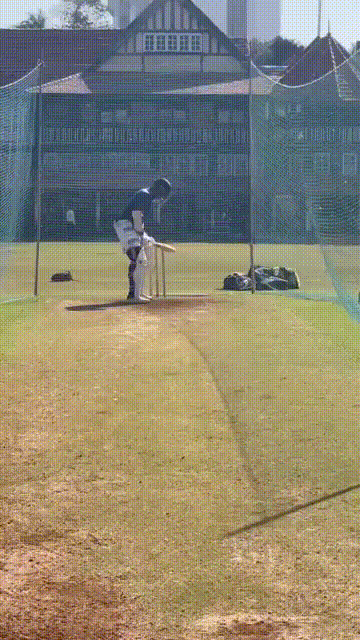 |
| **Telemetry Overlay** | **Telemetry Overlay** | **Telemetry Overlay** |
| 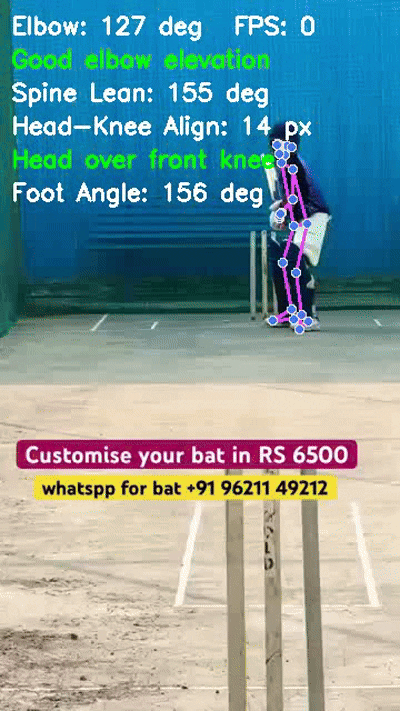 | 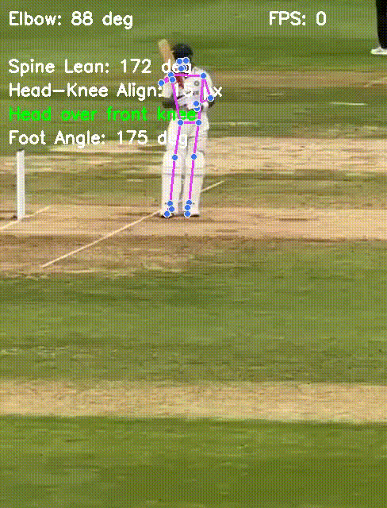 | 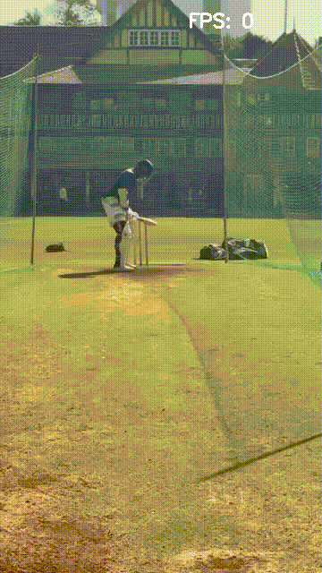 |
| **Kinematic Smoothness** | **Kinematic Smoothness** | **Kinematic Smoothness** |
| 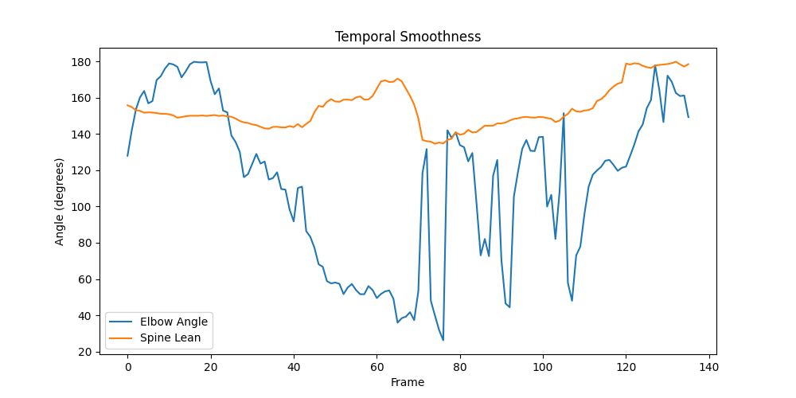 | 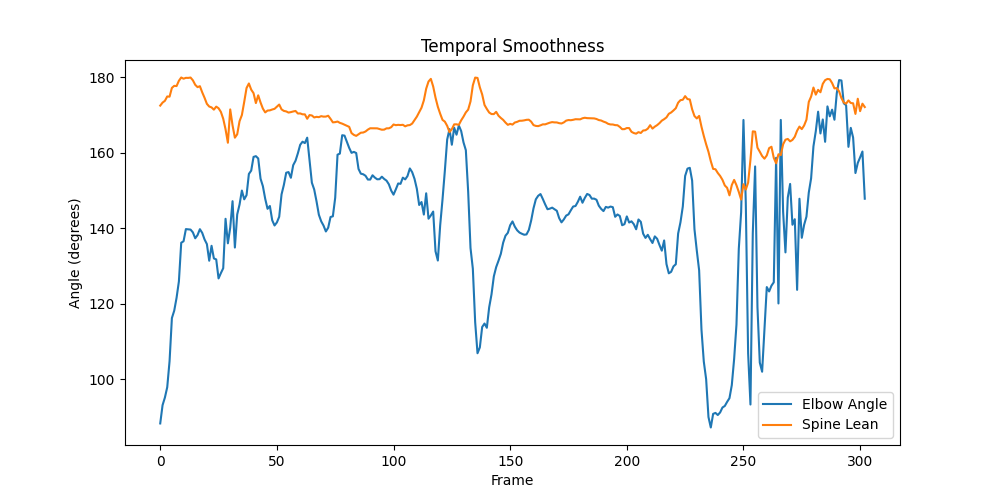 | 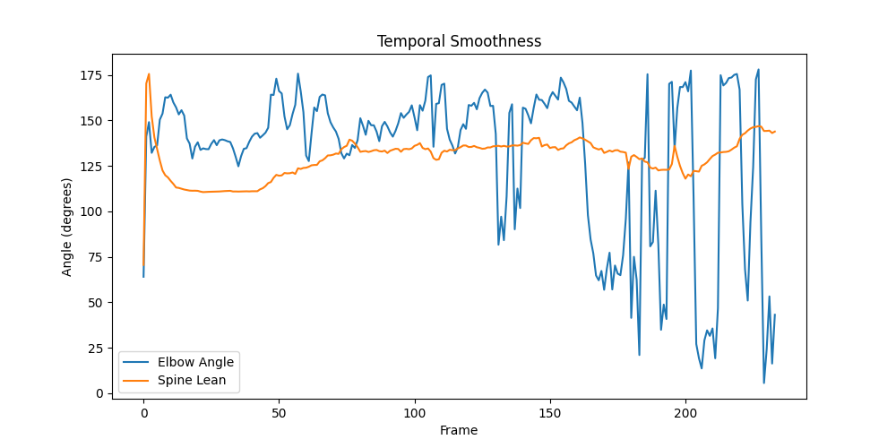 |

---

## ☁️ Streamlit Community Cloud Deployment Guide

AthleteRise is deployed publicly on Streamlit Community Cloud. You can open the live application here:

**https://ai-powered-multi-shot-cricket-batting-analytics-jw563gyvnpfn3c.streamlit.app/**

### Deploy your own copy
1. Sign in to [Streamlit Community Cloud](https://share.streamlit.io/) with the GitHub account that can access the repository.
2. Select **Create app** → **Deploy a public app from GitHub**.
3. Choose the repository: `NShiddharth/AI-Powered-Multi-Shot-Cricket-Batting-Analytics`.
4. Set **Branch** to `main`.
5. Set **Main file path** to `app.py`.
6. Open **Advanced settings** and select **Python 3.11** (the version used for the current deployment).
7. Leave **Secrets** empty unless you later add a feature that requires credentials.
8. Save the settings and click **Deploy**.

Streamlit Community Cloud reads dependencies from the repository. This project includes:
- `requirements.txt` for Python packages.
- `packages.txt` for required Linux system packages.
- `.streamlit/config.toml` for Streamlit configuration.

### Update the deployed application
The deployed app is connected to the GitHub repository. To publish code changes, commit and push them to the `main` branch:
```bash
git add .
git commit -m "Describe your update"
git push origin main
```
Streamlit Community Cloud detects repository changes and updates the app. Changes to dependencies may trigger a longer rebuild.

### Deployment troubleshooting
- If the build fails, open the app's **Manage app** menu and inspect the deployment logs.
- Check that `app.py`, `requirements.txt`, and `packages.txt` are present at the repository root.
- Keep Python package versions compatible with the selected Python version.
- If video processing exceeds the available resources, test with a shorter, lower-resolution clip and review the app logs.

For official instructions, see the [Streamlit Community Cloud deployment documentation](https://docs.streamlit.io/deploy/streamlit-community-cloud/deploy-your-app).

---

## ⚠️ Limitations & Technical Constraints

- **Monocular 2D Perspective:** 2D monocular tracking computes planar projections of 3D joint movements; extreme diagonal camera angles can introduce foreshortening effects on elbow and knee angles.
- **Lighting and Motion Blur:** Fast deliveries with heavy motion blur can reduce visual ball tracking confidence; the system gracefully relies on kinematic pose impact estimation and trajectory inflection when ball tracking is unavailable.
- **Occlusion from Equipment:** Pads and protective batting gear can partially obscure the front ankle keypoint during deep forward defensive strides; optical-flow interpolation mitigates this.
- **Streamlit Community Cloud resources:** Community Cloud apps run with shared resource limits that can vary and may change. Large 4K videos, long clips, or high-frame-rate footage may exceed available CPU or memory. Start with short, lower-resolution clips and increase input size only after testing.

---

## 🔮 Future Enhancements & Roadmap

As detailed in the [Project Master Documentation](docs/PROJECT_MASTER_DOCUMENTATION.md), planned future capabilities include:
1. **Bowling Phasing Integration:** Extend analysis to bowling biomechanics (Run-up, Bound, Back Foot Contact, Front Foot Contact, Release, and Follow-Through).
2. **RTMPose-M Keypoint Model:** Migrate from MediaPipe to RTMPose-M (17 COCO keypoints) with ONNX Runtime for higher precision at 60–120 FPS.
3. **Spatio-Temporal Graph Neural Networks (ST-GCN / CTR-GCN):** Replace heuristic kinematic feature distances with spatio-temporal graph convolutions for end-to-end stroke recognition.
4. **FAISS Vector Embedding Retrieval:** Index hundreds of elite professional batting swings into a vector database for nearest-neighbor technique matching and personalized recommendations./badge/Cloud-Streamlit%20Community%20Cloud-orange.svg)]()
[]()

---

## 🌐 Live Demo

**Try AthleteRise:** [Launch the public Streamlit application](https://ai-powered-multi-shot-cricket-batting-analytics-jw563gyvnpfn3c.streamlit.app/)

> Hosted on Streamlit Community Cloud. The app may take a short time to wake up after a period without visitors.

---

**AthleteRise** is an automated, markerless computer-vision system designed for multi-shot cricket batting biomechanics analysis. Operating on monocular 2D standard-definition and high-definition video, AthleteRise applies CLAHE lighting normalization, tracks 15 full-body skeletal keypoints using Google MediaPipe Pose, detects stroke phases and bat–ball impact moments via multi-signal kinematic fusion, classifies strokes across three major shot archetypes (**Cover Drive**, **Straight Drive**, and **Pull Shot**), and evaluates biomechanical technique against empirical statistical distributions ($N=30$, 10 benchmark clips per shot class) with continuous non-linear scoring, dynamic occlusion handling, and human-in-the-loop ground-truth validation.

---

## 📖 Complete Technical Documentation

> [!IMPORTANT]
> **Authoritative Technical Documentation:**  
> 📑 **[PROJECT_MASTER_DOCUMENTATION.md](docs/PROJECT_MASTER_DOCUMENTATION.md)** — The comprehensive, authoritative master document containing the complete technical audit, mathematical formulas, 10 core + shot-specific biomechanical metrics, statistical calibration methodology, multi-signal contact detection, and 43-case test verification.

---

## 🎯 Problem Statement

Traditional cricket coaching and biomechanical assessment rely heavily on subjective visual observation or expensive marker-based 3D motion-capture laboratories (e.g., Vicon) requiring wearable sensors that restrict natural player movement. Furthermore:
1. **Subjectivity:** Coach evaluations often vary significantly due to human visual limitations at high ball speeds.
2. **Single-Shot Limitation:** Prior automated cricket tools only addressed isolated strokes (such as single cover drives) without shot classification or shot-specific biomechanical models.
3. **Contact Detection Ambiguity:** Accurately localizing the exact frame of bat-ball impact from monocular broadcast or training video is challenging due to high bat speeds and motion blur.
4. **Lack of Empirical Baselines:** Existing platforms often score technique against arbitrary hardcoded angles rather than empirical distributions derived from high-level technical references.

AthleteRise solves these challenges by combining markerless deep pose estimation, trajectory change analysis, shot classification, empirical percentile-based scoring ($P_{10} - P_{90}$), and interactive visual telemetry into an accessible web dashboard.

---

## 🌟 Main Objectives

- **Automated Multi-Shot Analysis:** Automatically classify the stroke played (**Cover Drive**, **Straight Drive**, **Pull Shot**, or **Unknown**) without manual pre-labeling.
- **Markerless Kinematic Tracking:** Extract 15 spatial-temporal skeletal keypoints with scale-invariance normalized by player torso length.
- **Multi-Signal Bat-Ball Contact Fusion:** Estimate contact frame using spatial proximity, velocity vectors, trajectory inflection, and pose impact windows.
- **Empirical Reference Calibration:** Benchmark technique against calibrated statistical baselines ($N=30$ dedicated video clips), computing 11 statistical descriptors (Mean, Median, Std Dev, Variance, Min, Max, Q1, Q3, IQR, P10, P90).
- **Interactive Coaching Dashboard:** Provide coaches and players with immediate visual overlays, biomechanical scorecards, temporal smoothness curves, and downloadable PDF/HTML reports.
- **Human-in-the-Loop Validation:** Provide annotation tools to confirm contact frames and build expanding validation datasets.

---

## ⚡ Key Features

- **3-Tab Modular Interface:**
  1. `🎥 Single Video Shot Analysis`: Video upload, automatic shot classification, bat-ball contact detection, 10 core biomechanical metrics, percentile scorecard, and annotated video player.
  2. `📐 Multi-Shot Reference Calibration`: Statistical reference browser, per-metric box plots, comparative cross-shot diagnostics, and one-click recalibration across 30 dedicated reference clips.
  3. `🎯 Contact Validation & Annotation`: Human-in-the-loop review of candidate contact frames (Before / Contact / After) to confirm ground truth and track detector precision/recall.
- **10 Core Biomechanical Metrics:**
  - Front Elbow Angle (°)
  - Spine Lean Tilt (°)
  - Head–Knee Alignment (torso-normalized distance)
  - Front Foot Direction (°)
  - Shoulder Rotation (°)
  - Hip Rotation (°)
  - Stride Length (torso-normalized ratio)
  - Head Stability (drift standard deviation)
  - Follow-Through Angle (°)
  - Follow-Through Quality (0–100 score)
- **Shot-Specific Distinguishing Metrics:**
  - Rotary Shoulder Differential (°)
  - Wrist Horizontal & Vertical Travel (torso-normalized)
- **Continuous Non-Linear Percentile Scoring:**
  - Eliminates brittle binary pass/fail thresholds.
  - Scores scale smoothly within the empirical 10th-to-90th percentile bounds ($P_{10} - P_{90}$).
- **Automated Report Generation:**
  - Full HTML & downloadable JSON telemetry outputs.
  - Diagnostic matrix comparing Cover Drive vs. Straight Drive vs. Pull Shot technique.
- **Robustness & Fallback Handling:**
  - Dual MediaPipe support (MediaPipe Tasks API `pose_landmarker_lite.task` with automatic fallback to MediaPipe Solutions Pose).
  - Works on both left-handed and right-handed batsmen.
  - Dynamic occlusion handling with optical-flow keypoint propagation.

---

## 🏗️ System Architecture


---

## 🛠️ Technology Stack

| Layer | Technologies / Libraries |
| :--- | :--- |
| **Language** | Python 3.10+ (tested on 3.10 and 3.14) |
| **Web Application** | Streamlit (v1.32.0 – v1.60.0) |
| **Computer Vision** | OpenCV Headless (`opencv-python-headless`), Google MediaPipe (`mediapipe 0.10.x`) |
| **Biomechanical Math** | NumPy, Pandas, SciPy |
| **Data Visualization** | Matplotlib, Streamlit Charts |
| **Model Artifacts** | `pose_landmarker_lite.task` (TFLite CPU delegate) |
| **Testing** | Python `unittest` (43 automated test cases passing) |
| **Deployment Target** | Streamlit Community Cloud (Debian Linux, Python 3.10 container) |

---

## 📁 Project Folder Structure

```
AI-Powered-Cricket-Analytics-main/
│
├── .streamlit/
│   └── config.toml               # Streamlit server, upload limit (200MB), and theme settings
├── calibration_dataset/          # Reference dataset documentation
│   └── cover_drive/README.txt
├── data/
│   ├── contact_annotations/      # Stored human-in-the-loop ground-truth labels
│   │   └── temp_contact_label.json
│   └── reference_videos/         # Dedicated empirical calibration clips (30 clips, ~45.5 MB)
│       ├── cover_drive/          # 10 Cover Drive reference clips (cover_0001 - cover_0010.avi)
│       ├── straight_drive/       # 10 Straight Drive reference clips (straight_0101 - straight_0110.avi)
│       └── pull_shot/            # 10 Pull Shot reference clips (pull_0111 - pull_0120.avi)
├── docs/
│   └── PROJECT_MASTER_DOCUMENTATION.md  # Complete mathematical audit and technical specs
├── examples/                     # Demonstration animations and telemetry graphs
│   ├── annotated_video.gif
│   ├── annotated_left_hander_batsmen.gif
│   ├── annotated_left_side_angle.gif
│   ├── input_video.gif
│   ├── input_left_hander_batsmen.gif
│   ├── input_left_side_angle.gif
│   ├── temporal_smoothness.png
│   └── evaluation.json
├── frames/                       # Frame storage directory (retained via .gitkeep)
│   └── .gitkeep
├── output/                       # Generated analysis artifacts & calibration baselines
│   └── reference_calibration/    # Precomputed empirical baselines for all 3 shots
│       ├── cover_drive/          # Reference JSON, statistics CSV, distribution PNG, HTML report
│       ├── straight_drive/       # Reference JSON, statistics CSV, distribution PNG, HTML report
│       ├── pull_shot/            # Reference JSON, statistics CSV, distribution PNG, HTML report
│       ├── calibration_diagnostics.txt
│       └── calibration_validation_report.txt
├── scripts/                      # Evaluation & dataset inspection utilities
│   ├── evaluate_dataset.py
│   ├── evaluate_models.py
│   ├── generate_multishot_dataset.py
│   └── inspect_per_video.py
├── src/                          # Modular core application logic
│   ├── biomechanics/             # Metrics calculators & scale invariance algorithms
│   ├── calibration/              # Reference calibration engines & statistical analyzers
│   ├── contact_detection/        # Bat-ball visual detector, contact estimator & validator
│   ├── evaluation/               # Shot-specific scoring engines & feedback generators
│   ├── phase_detection/          # Stroke phase segmentation engines
│   ├── pose_estimation/          # MediaPipe vision posture tracker
│   ├── preprocessing/            # Video reader, CLAHE normalization, stride sampling
│   ├── report/                   # HTML/PDF calibration report generator
│   ├── reporting/                # Multi-shot and contact text formatters
│   └── shot_analysis/            # Shot classifier, config, and feature extractors
├── tests/                        # Automated unit test suite (43 test cases)
│   ├── test_audit_architecture.py
│   ├── test_audit_step19_pipeline.py
│   ├── test_biomechanical_statistics.py
│   └── test_multi_shot_analysis.py
│
├── .gitattributes                # Git text normalization and binary settings
├── .gitignore                    # Production deployment ignore rules
├── app.py                        # Streamlit web application entry point
├── calibrate_references.py       # Standalone calibration orchestrator
├── config.json                   # Pipeline configuration thresholds
├── cover_drive_analysis_realtime.py # Core analysis pipeline CLI
├── packages.txt                  # Linux system packages for Streamlit Cloud (ffmpeg, libgl1)
├── pose_landmarker_lite.task     # MediaPipe PoseLandmarker model weights (5.51 MB)
├── README.md                     # Project documentation
├── requirements.txt              # Production Python dependencies
│
├── Cover_drive_Input.mp4         # Sample Cover Drive input video (1.82 MB)
├── Cover_drive_Input_2.mp4       # Sample Cover Drive input video #2 (5.11 MB)
├── Pull_Shot_Input.mp4           # Sample Pull Shot input video (3.10 MB)
└── Straight_drive_Input.mp4      # Sample Straight Drive input video (1.10 MB)
```

---

## 💻 Installation & Setup

### Prerequisites
- Python **3.10** (recommended) or 3.11 / 3.12 / 3.14
- Git

### 1. Clone the Repository
```bash
git clone https://github.com/NShiddharth/AI-Powered-Multi-Shot-Cricket-Batting-Analytics.git
cd AI-Powered-Multi-Shot-Cricket-Batting-Analytics
```

### 2. Create and Activate Virtual Environment
```bash
# Windows
py -3.10 -m venv cricket_analytics
cricket_analytics\Scripts\activate

# Linux / macOS
python3.10 -m venv cricket_analytics
source cricket_analytics/bin/activate
```

### 3. Install Dependencies
```bash
pip install -r requirements.txt
```

---

## 🚀 Running the Application Locally

### Option A: Launch Interactive Streamlit Web App (Recommended)
```bash
streamlit run app.py
```
Open your browser at `http://localhost:8501`.

### Option B: Standalone CLI Video Analysis
```bash
# Analyze a sample video with automatic shot classification
python cover_drive_analysis_realtime.py --video Cover_drive_Input.mp4

# Run with custom configuration
python cover_drive_analysis_realtime.py --video Straight_drive_Input.mp4 --config config.json
```

### Option C: Re-run Full Empirical Reference Recalibration
```bash
python calibrate_references.py
```

### Option D: Run Automated Unit Tests
```bash
python -m unittest discover tests
```
*All 43 unit tests execute in ~11 seconds and verify architecture, scoring, phase detection, contact estimation, and statistical distributions.*

---

## 📖 How to Use the Application

### 1. Single Video Shot Analysis (`Tab 1`)
1. Open the web app at `http://localhost:8501`.
2. Under **Shot Classification Mode**, leave as `Auto-Detect Shot (Recommended)` or choose a forced baseline.
3. Click **Browse files** and upload an MP4 or AVI video (you can use one of the bundled sample videos: `Cover_drive_Input.mp4`, `Straight_drive_Input.mp4`, or `Pull_Shot_Input.mp4`).
4. Click **🚀 Run Batting Analysis**.
5. Inspect:
   - **Annotated Video Overlay** with skeletal wireframe, bat path, and impact telemetry.
   - **Classification Result** showing predicted shot type and confidence percentage.
   - **Bat–Ball Contact Analysis** displaying contact status, frame number, proximity, and multi-signal breakdown.
   - **Biomechanical Scorecard** with measured values, baseline means, $P_{10} - P_{90}$ ranges, and technique advice.
   - **Reference Baseline Distribution Expander** displaying box plots across the 10 benchmark reference clips.

### 2. Multi-Shot Reference Calibration (`Tab 2`)
1. Select the shot class (**Cover Drive**, **Straight Drive**, or **Pull Shot**).
2. View the precomputed empirical dataset statistics ($N=10$ clips per shot) across all 10 biomechanical metrics.
3. Toggle between **Multi-Metric Overview** (grid of box plots) and **Single Metric Deep Dive** with per-video data.
4. Download the high-resolution Distribution Dashboard (`PNG`) or full HTML Calibration Report.
5. Optionally click **▶ Run Calibration** to reprocess all dedicated video clips and update the empirical distribution in real-time.

### 3. Contact Validation & Annotation (`Tab 3`)
1. View the total number of stored ground-truth contact labels.
2. Review the 3-frame impact window extracted from the most recently analyzed video:
   - **Frame Before**
   - **🎯 Candidate Contact Frame**
   - **Frame After**
3. Click **✅ CONFIRM CONTACT**, **❌ NO CONTACT**, or **❓ UNCERTAIN** to save the human-verified label into `data/contact_annotations/`.
4. The detector's precision, recall, and F1-score automatically update against verified ground truth.

---

## 🎥 Visual Demonstrations

| Front Angle | Side Angle | Left-Handed Batsman |
| :---: | :---: | :---: |
| **Input Clip** | **Input Clip** | **Input Clip** |
|  |  |  |
| **Telemetry Overlay** | **Telemetry Overlay** | **Telemetry Overlay** |
|  |  |  |
| **Kinematic Smoothness** | **Kinematic Smoothness** | **Kinematic Smoothness** |
|  |  |  |

---

## ☁️ Streamlit Community Cloud Deployment Guide

AthleteRise is deployed publicly on Streamlit Community Cloud. You can open the live application here:

**https://ai-powered-multi-shot-cricket-batting-analytics-jw563gyvnpfn3c.streamlit.app/**

### Deploy your own copy
1. Sign in to [Streamlit Community Cloud](https://share.streamlit.io/) with the GitHub account that can access the repository.
2. Select **Create app** → **Deploy a public app from GitHub**.
3. Choose the repository: `NShiddharth/AI-Powered-Multi-Shot-Cricket-Batting-Analytics`.
4. Set **Branch** to `main`.
5. Set **Main file path** to `app.py`.
6. Open **Advanced settings** and select **Python 3.11** (the version used for the current deployment).
7. Leave **Secrets** empty unless you later add a feature that requires credentials.
8. Save the settings and click **Deploy**.

Streamlit Community Cloud reads dependencies from the repository. This project includes:
- `requirements.txt` for Python packages.
- `packages.txt` for required Linux system packages.
- `.streamlit/config.toml` for Streamlit configuration.

### Update the deployed application
The deployed app is connected to the GitHub repository. To publish code changes, commit and push them to the `main` branch:
```bash
git add .
git commit -m "Describe your update"
git push origin main
```
Streamlit Community Cloud detects repository changes and updates the app. Changes to dependencies may trigger a longer rebuild.

### Deployment troubleshooting
- If the build fails, open the app's **Manage app** menu and inspect the deployment logs.
- Check that `app.py`, `requirements.txt`, and `packages.txt` are present at the repository root.
- Keep Python package versions compatible with the selected Python version.
- If video processing exceeds the available resources, test with a shorter, lower-resolution clip and review the app logs.

For official instructions, see the [Streamlit Community Cloud deployment documentation](https://docs.streamlit.io/deploy/streamlit-community-cloud/deploy-your-app).

---

## ⚠️ Limitations & Technical Constraints

- **Monocular 2D Perspective:** 2D monocular tracking computes planar projections of 3D joint movements; extreme diagonal camera angles can introduce foreshortening effects on elbow and knee angles.
- **Lighting and Motion Blur:** Fast deliveries with heavy motion blur can reduce visual ball tracking confidence; the system gracefully relies on kinematic pose impact estimation and trajectory inflection when ball tracking is unavailable.
- **Occlusion from Equipment:** Pads and protective batting gear can partially obscure the front ankle keypoint during deep forward defensive strides; optical-flow interpolation mitigates this.
- **Streamlit Community Cloud resources:** Community Cloud apps run with shared resource limits that can vary and may change. Large 4K videos, long clips, or high-frame-rate footage may exceed available CPU or memory. Start with short, lower-resolution clips and increase input size only after testing.

---

## 🔮 Future Enhancements & Roadmap

As detailed in the [Project Master Documentation](docs/PROJECT_MASTER_DOCUMENTATION.md), planned future capabilities include:
1. **Bowling Phasing Integration:** Extend analysis to bowling biomechanics (Run-up, Bound, Back Foot Contact, Front Foot Contact, Release, and Follow-Through).
2. **RTMPose-M Keypoint Model:** Migrate from MediaPipe to RTMPose-M (17 COCO keypoints) with ONNX Runtime for higher precision at 60–120 FPS.
3. **Spatio-Temporal Graph Neural Networks (ST-GCN / CTR-GCN):** Replace heuristic kinematic feature distances with spatio-temporal graph convolutions for end-to-end stroke recognition.
4. **FAISS Vector Embedding Retrieval:** Index hundreds of elite professional batting swings into a vector database for nearest-neighbor technique matching and personalized recommendations.
